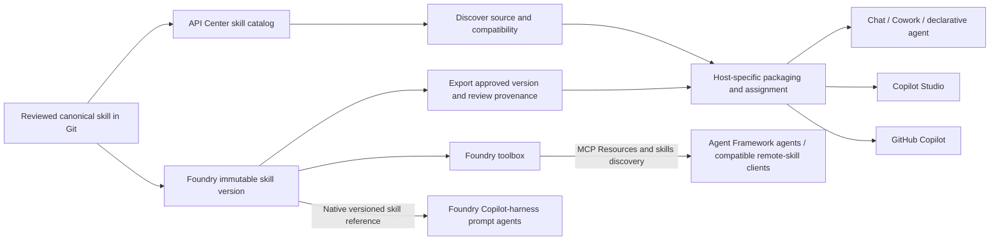

# Central skill management: Foundry + Azure API Center

**Centrally manage skill versions in Foundry and catalog them in API Center.
Foundry prompt agents using the Microsoft Copilot engine load selected skill
versions directly. Microsoft Agent Framework agents and other clients
supporting MCP Resources and skills discovery retrieve skills through a
Foundry toolbox's MCP endpoint (preview).**

API Center lists **Skill** entries with source links, release stages such as
Testing, and information about supported products and clients. It also
supports optional assessments and synchronization with a Git repository.
Foundry supports immutable skill versions, content export, and preview
toolbox-based remote skill discovery for compatible clients.
The **Microsoft Copilot harness** is the agent engine selected in Foundry;
an **immutable version** is saved content that cannot later be edited.

## Find and consume a centrally managed skill

1. Open your organization's API Center portal, if one has been published, or
   the API Center resource's **Inventory > Assets** page if you have Azure
   access. Search for the intended **Skill** entry.
2. Review its description, source link, approved version and compatibility.
   The catalog helps you choose instructions; it is not itself a chat agent.
3. Follow the connection appropriate to your application in the table below:
   a Foundry skill reference, or a supported toolbox MCP connection.
4. If your target is Chat, Cowork, Studio or a coding client without verified
   remote skill discovery, follow that product's packaging/installation guide
   instead of assuming a generic MCP connection loads instructions.

Application users usually use the resulting agent or application. Developers
and administrators configure its skill reference or server connection.

## Where to manage each part

- **Catalog entry:** Azure portal > **API Centers > select your API Center >
  Inventory > Assets > select the Skill entry**. Use **Edit** for its
  description, source link and compatibility information.
- **Catalog's Git synchronization:** in the same API Center, open
  **Platforms > Integrations > select the Git integration**.
- **Stored skill versions:** in VS Code, open **Microsoft Foundry Toolkit**
  for the intended project, then **Tools > Skills > select the skill**, or
  use the project's Skills API.
- **Remote connection:** configure the consuming application to use the
  chosen Foundry toolbox endpoint, not the API Center resource address.

**MCP** means Model Context Protocol: the connection used here to discover
and retrieve skill content from a server. A **toolbox** is a named, versioned
Foundry bundle; its **endpoint** is the HTTPS address the application connects
to. **MCP Resources** carry retrievable content such as skill instructions;
they are distinct from tools that execute actions.

## Who consumes the skills, and through which connection?

| Consumer | Connection to the centrally managed skill |
| --- | --- |
| Foundry prompt agents using the Microsoft Copilot harness | The agent's saved configuration selects a skill version from the same Foundry project. Configure it through the Foundry Agent Service API/SDK or supported tooling; the selected version's content cannot be edited after creation. |
| Microsoft Agent Framework agents, including hosted agents | An authenticated connection to the Foundry toolbox's **MCP endpoint over HTTPS**. Python's `FoundryToolbox.as_skills_provider()` and .NET's `UseMcpSkills` load skill content through MCP Resources. |
| Other MCP clients implementing remote skill discovery | The same Foundry toolbox MCP endpoint, with **MCP Resources and the skills discovery extension**: `resources/list` discovers skills and `resources/read` retrieves their content. Generic MCP tool support alone is insufficient. |

API Center provides the discovery/catalog connection: its portal links to the
reviewed skill source and compatibility information. The runtime connections
above go to **Foundry**, not API Center. Git synchronization updates the
catalog; it does not automatically create Foundry skill versions or attach
them to agents/toolboxes.

API Center is a searchable catalog; it does not run skills or serve their
instructions to an agent at runtime. Registering a skill does not install it
in Copilot or give recipients Foundry access.

## A. Register the skill and distribute reviewed packages

1. Publish the canonical skill source to Git.
2. Create the Foundry version using the [Foundry guide](../foundry/README.md).
3. Export the approved immutable version using `Invoke-FoundrySkill.ps1`.
   Record the version and archive hash. Review the content; do not overwrite
   the canonical source automatically.
4. API Center > Inventory > Assets > Register an asset > **Skill**.
5. Use title Meeting Notes, identifier meeting-notes, a release stage such as Testing,
   and this source:
   `https://github.com/jameswh3/msft-skills-deployment-examples/tree/main/skills/meeting-notes`.
   For an approved release, use a commit-specific source URL.
6. Describe the skill as instructions only, with no external tools required.
   Use the catalog's documentation/metadata fields to link the approved
   release and record its source commit and exported archive hash.
   Do not put credentials in the catalog.
7. Optionally configure Platforms > Integrations > From Git repository for
   this repository's `skills` folder. Verify the pattern matches uppercase
   **SKILL.md**: the documented default displays `**/skill.md`, so do not
   assume case-insensitive matching.
8. Use the API Center portal to discover the skill, inspect the source and
   approved version, then follow the target host's install/assignment guide.

The documented Git integration is not a direct automatic Foundry-to-API-Center
skill synchronization connector. In a Foundry-first workflow, export and review
the approved content into Git before synchronizing the catalog.

For this public sample, Git synchronization does not require a repository
personal access token (PAT).
For private repositories, the documented integration uses a PAT stored in Azure Key Vault
and API Center managed-identity access to that secret. Never put the PAT into
source or an example JSON file.

Prefer the Free API Center plan for evaluation. Check current feature limits
before enabling assessments, portal features, or Git integrations; do not
silently upgrade to Standard or provision API Management/hosting.

## B. Optional direct remote discovery

Attach the versioned Foundry skill to a toolbox in the **same Foundry project**.
Use a pinned skill version and the versioned toolbox endpoint.

The consumer must support **MCP Resources and the skills discovery extension**:
it lists and reads skills rather than merely listing/calling tools. Microsoft
Agent Framework documents .NET's `UseMcpSkills` and Python's
`FoundryToolbox.as_skills_provider()` as consumption paths.

| Consumer | Support and required checks |
| --- | --- |
| Microsoft Agent Framework agents and other clients implementing MCP Resources/skills discovery | Documented preview consumption through a Foundry toolbox's authenticated MCP endpoint; verify authentication, version and actual skill load. |
| Microsoft 365 Chat/declarative agents/Cowork | Native packaging is documented; generic MCP tool connectivity is not proof of remote toolbox skill loading. |
| Copilot Studio | Native upload/sharing is documented; do not assume MCP tool support loads remote skills. |
| GitHub Copilot | Local/repository/plugin skills are documented; check that the specific client implements remote skill discovery before choosing the toolbox route. |

## C. Calling a hosted capability is a different pattern

It is possible to design an API/MCP tool that invokes a Foundry agent using the
skill, then connect a host to that tool. That **executes the task remotely**;
it does not install or load the skill into the consumer.

That adapter requires hosting, an API contract, per-caller authentication,
authorization, data-boundary decisions, billing, error handling, and runtime
tests. This instruction-only example does not include that adapter. API Center
cataloging alone supplies none of those runtime capabilities.

## Update, rollback and revoke

Choose the reviewed Foundry version and update the catalog to identify it.
For installed copies, rebuild and distribute each product's package. For
remote connections, update the skill/toolbox versions selected by each
application, then test that it loads the intended content.
To roll back, restore the previous versions in each affected agent or
application as well as in the catalog. Removing the catalog entry does not
remove installed copies or stop applications from using them; use the
relevant product's removal or access controls.

To update catalog information, open **Azure portal > API Centers > select the
resource > Inventory > Assets > select the skill > Edit**, change the reviewed
properties and save. For a Git-synchronized entry, maintain its source and
check the integration status rather than assuming edits propagate to Foundry.

## Troubleshooting

- **Entry exists but the application cannot load the skill:** catalog access
  is separate from authentication/permission to the Foundry project or toolbox.
- **MCP tools work but skills do not appear:** confirm the client supports
  MCP Resources and skills discovery, not just tool calls.
- **Git updates are absent:** inspect **Platforms > Integrations** and the
  configured source/pattern; check the case of `SKILL.md`.
- **New default has no effect:** check the agent or toolbox's selected
  version. Updating a catalog entry does not change those references.

Sources: [Register skills](https://learn.microsoft.com/azure/api-center/register-discover-skills),
[Git synchronization](https://learn.microsoft.com/azure/api-center/synchronize-assets-git),
[API Center's design-time boundary](https://learn.microsoft.com/azure/api-center/overview),
[Foundry skills](https://learn.microsoft.com/azure/foundry/agents/how-to/tools/skills),
[Agent Framework toolbox](https://learn.microsoft.com/agent-framework/integrations/by-component/tools/foundry-toolbox).
